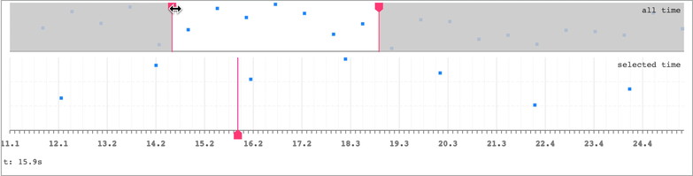
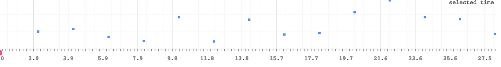
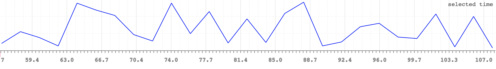
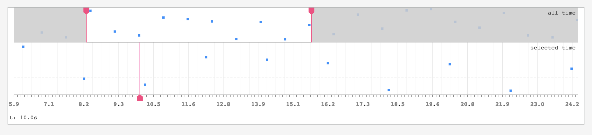

# snabbdom-timeline

an interactive timeline web component (`<snabbdom-timeline>`), implemented with snabbdom




## features
* can stack multiple graphs
* single time or ranged time selectors, draggable with mouse, touch or pen
* data oriented, functional design
* a standard custom element: works in plain html or with any framework
* small, < 1,000 lines of code
* renders with SVG or canvas


## usage

via `npm`:
```
npm install snabbdom-timeline
```

```javascript
import 'snabbdom-timeline'  // registers <snabbdom-timeline>
```

via pure http es module:
```html
import 'https://esm.sh/snabbdom-timeline'
```

The module also exports the element class: `import { SnabbdomTimeline } from 'snabbdom-timeline'`.


```html
<snabbdom-timeline renderer="svg"></snabbdom-timeline>

<script type="module">
import 'snabbdom-timeline'

const timeline = document.querySelector('snabbdom-timeline')

// contains all data needed to render the graphs
timeline.graphs = [
    {
        title: 'test title',  // accessible name for the graph
        label: 'title',
        type: 'scatterPlot',  // scatterPlot | linePlot
        timeRange: {
            start: 0,  // seconds
            end: 0     // seconds
        },
        yRange: {
            start: 0,
            end: 100
        },

        // optional: render a selection control
        selection: {
            type: 'range',
            start: 0,       // seconds | 0
            end: Infinity,  // seconds | Infinity
            dragging: false
        },

        height: 40,              // pixels
        dataColor: 'dodgerblue', // color of data points on the graph
        linePlotAreaColor: 'rgba(41, 147, 251, 0.3)', // optional: fill the area under a linePlot
        renderTicks: false,
        renderValueLabel: false,

        // the data points to render
        data: [ ],

        // optional: settings for grid background lines
        gridLines: {
            vertical: {
                majorColor: '#dedede',
                minorColor: '#f3f3f3',
                ticksPerMinor: 2.5,
                ticksPerMajor: 10
            },
            horizontal: {
                color: '#eeeeee',
                lineCount: 2
            }
        }
    }
]


// pump test data into the graph
setInterval(function () {
    const graph = timeline.graphs[0]
    const t = performance.now() / 1000
    const value = graph.yRange.start + Math.round(Math.random() * (graph.yRange.end - graph.yRange.start))

    graph.data.push({ t, value })
    graph.timeRange.end = t

    timeline.update()  // re-render after mutating graph data
}, 2000)

timeline.addEventListener('change', (ev) => {
    console.log('selection changed', ev.detail.selection)
})
</script>
```


## api

### attributes / properties

| name | type | description |
| --- | --- | --- |
| `renderer` | `'svg'` \| `'canvas'` | attribute and property (kept in sync). defaults to `svg`. see [renderer option](#renderer-option) |
| `graphs` | `Array` | property. the graph configs/data to render (schema above). assigning it schedules a render |

### methods

| name | description |
| --- | --- |
| `update()` | schedule a re-render on the next animation frame. call this after mutating `graphs` in place (e.g. pushing data). multiple calls in the same frame result in a single render |

### events

The element updates `graph.selection` in place as the user drags a selection control
(`start`/`end` for `range` selections, `time` for `value` selections), and dispatches:

| name | when |
| --- | --- |
| `input` | continuously while a selection control is dragged |
| `change` | once when a drag ends (the pointer is released, or the browser cancels it, e.g. to scroll), if the selection changed |

Both events bubble, and `event.detail` is `{ graph, graphIndex, selection }`. The element re-renders after
dispatching `input`, so listeners can adjust other graphs (e.g. linking one graph's time range to another
graph's selection) without calling `update()` themselves.

While dragging, `selection.dragging` is set to `'start'`, `'end'` or `'time'`.

## graph types

There are 2 available graph types:

### scatterPlot




### linePlot




## linked graphs

Graphs can be linked together. Here an "all time" graph's range selection drives the time range of a
"selected time" graph below it:



You can run the example (see [development](#development)) to try this out.


## renderer option

by default, snabbdom-timeline will use `svg` to render these graphs. These are nice in that they are semantic elements, and are probably more accesible.

However, if you're rendering a _lot_ of graphs with frequently updating data, you may find the svg based rendering performance is insufficient.

For example, in one of my projects I'm
rendering 50 of these graphs, with new data coming in at 60 frames per second, and storing 1,000 data points per graph. Using virtual dom really bogs things down at this scale,
so in that case I use the `canvas` renderer option which has better performance, at the cost of less semantically friendly markup.


## development

```bash
npm install
npx serve . --no-etag
open http://localhost:3000/example.html
```
